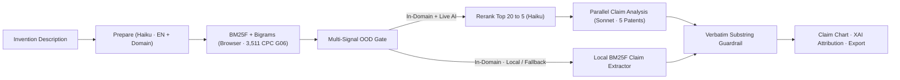

# Verbatim

**Prior art, word for word.** Verbatim retrieves the 5 closest published US patent applications to a technical invention description, builds a claim-by-claim overlap chart, and verifies every cited passage character-for-character against the source claim text in code.

Any quote that is paraphrased, truncated, case-altered, or fabricated is rejected automatically, flagged as `Unverified`, and accompanied by a structured root-cause diagnostic.

---

## Architecture Overview



- **Single retrieval & guardrail engine (`shared/engine.mjs`)**: Shared directly across the React/TypeScript workbench, the Vercel serverless endpoint (`api/claude.js`), the reproducible benchmark runner, and the Vitest suite.
- **Deterministic verbatim guardrail**: Every quote must be an exact substring (`>= 12` characters) of the source claim with zero silent normalization. Failed quotes are discarded and classified (`case_mismatch`, `whitespace_or_punctuation_drift`, `ellipsis_or_omission`, `paraphrase_high_overlap`, or `hallucination_low_overlap`).
- **Full explainability (XAI)**: Displays multi-field BM25F attribution (`Title`, `Abstract`, `Independent claims`, `Dependent claims`, `Technical phrases`), IDF-weighted top terms, an **Invention Element x Claim** coverage matrix, and an evidentiary audit trail.
- **Server-side prompt isolation**: `api/claude.js` constructs every Claude prompt on the server from the canonical frozen corpus (`public/data/corpus.json.gz`), enforces bounded per-IP and daily limits with standard `X-RateLimit-*` / `Retry-After` headers, and executes claim analyses in parallel per patent.

---

## Measured Retrieval & Guardrail Benchmarks

Evaluated on a fixed-seed held-out split (`scripts/benchmark_cases.json`: 20 known-item queries + 10 out-of-domain queries). The out-of-domain threshold (`0.47`) is calibrated strictly on the separate development split (`dev`).

| Metric (Held-Out Test) | Legacy Single-Field BM25 | Current BM25F + Bigrams | Delta |
| :--- | :---: | :---: | :---: |
| **Top-5 Recall** | 18 / 20 (90%) | **19 / 20 (95%)** | +5 pts |
| **Top-1 Precision** | 15 / 20 (75%) | **16 / 20 (80%)** | +5 pts |
| **Mean Reciprocal Rank (MRR)** | 0.8188 | **0.8542** | +0.0354 |
| **In-Domain Acceptance** | 20 / 20 (100%) | **20 / 20 (100%)** | — |
| **Out-of-Domain Refusal** | 9 / 10 (90%) | **9 / 10 (90%)** | wider margin |
| **Average Query Latency** | ~0.6 ms | **0.44 ms** | client-side |
| **Verbatim Quote Verification** | 100% exact | **100% exact + diagnostics** | strict |

---

## Quickstart

### Prerequisites
- **Node.js** `>= 22`
- **uv** (for the offline Python corpus pipeline and tests)
- Optional: `ANTHROPIC_API_KEY` for live Claude translation, reranking, and parallel claim analysis. Without a key, the full workbench runs locally in deterministic BM25F mode.

### Run Locally (Frontend + Local `/api/claude`)

```bash
# 1. Install frontend and serverless dependencies
npm install

# 2. Optional: configure live Claude analysis (loaded automatically by Vite dev middleware)
cp .env.example .env.local
# Add ANTHROPIC_API_KEY=sk-ant-... inside .env.local

# 3. Start Vite dev server (mounts /api/claude locally on the same origin)
npm run dev
```

Open `http://localhost:5173`.

### Rebuild Corpus Asset (Offline Python Pipeline with `uv`)

```bash
# Install Python pipeline and test dependencies
uv sync --extra dev

# Export data/patents.parquet -> public/data/corpus.json.gz + corpus_meta.json
uv run python -m pipeline.export_corpus

# Re-run dev/test benchmark and refresh public/data/benchmark.json
npm run benchmark
```

### Deploy on Vercel

The repository ships with a ready-to-deploy `vercel.json` targeting Vite (`dist/`) and the Node.js serverless function (`api/claude.js`) with `public/data/corpus.json.gz` bundled via `includeFiles`.

1. Connect the repository to Vercel (or run `npx vercel deploy --prod`).
2. Set `ANTHROPIC_API_KEY` in **Vercel Project Settings -> Environment Variables**.
3. Optionally configure `MAX_LIVE_CALLS_PER_DAY`, `VERBATIM_QUICK_MODEL`, or `VERBATIM_ANALYSIS_MODEL`.

---

## Example Workflow

1. Select a sample invention (e.g., *Invoice fraud graph detector*) or paste a 20–4,000 character technical description in English or French, optionally scoped to a CPC subclass (`G06F`, `G06Q`, `G06T`, `G06K`, `G06N`).
2. Inspect the live **Execution Trace** with real per-stage timings (`BM25F`, `Guardrail`, and when configured `Haiku` / `Sonnet`).
3. Review the **Claim Chart** tab with exact highlighted quotes and character offsets (`VERBATIM EXACT · [start..end]`), inspect score attribution and the element-to-claim matrix in **Explainability (XAI)**, browse the indented claim hierarchy in **Full Patent**, or export a Markdown claim chart (`Export .md` / `Print`).
4. Switch to **Benchmarks** in the top navigation bar to inspect held-out metrics, the out-of-domain separation chart, and launch any benchmark query directly in the workbench.

---

## Newcomer Map

| Path / Variable | Purpose |
| :--- | :--- |
| `shared/engine.mjs` | Core multi-field BM25F index, bigrams, OOD gate, strict verbatim guardrail, rejection diagnostics, XAI attribution, and prompt builders |
| `shared/engine.d.mts` | Strict TypeScript type definitions for `shared/engine.mjs` |
| `api/claude.js` | Vercel Node.js serverless handler (`prepare`, `rerank`, parallel per-patent `analyze`, bounded rate limiter, origin enforcement) |
| `src/App.tsx` | Top-level workbench & benchmarks state orchestration |
| `src/components/PatentInspector.tsx` | Claim Chart, Explainability (XAI), and Full Patent views + export controls |
| `src/styles/tokens.css` | Single source of truth for design tokens, semantic badge states, and typography |
| `pipeline/export_corpus.py` | Exports canonical Parquet data (`data/patents.parquet`) with CPC, dates, and claim dependencies to `public/data/corpus.json.gz` |
| `pipeline/evaluate_dense.py` | Offline dense embedding benchmark (`multilingual-e5-small`) for lexical vs semantic comparison |
| `scripts/benchmark.mjs` | Runs dev/test/OOD evaluation and writes `public/data/benchmark.json` |
| `docs/architecture.md` | Detailed mathematical, security, and guardrail specification |
| `ANTHROPIC_API_KEY` | Optional server-side credential enabling live Claude steps in `api/claude.js` |
| `MAX_LIVE_CALLS_PER_DAY` | Per-instance daily cap on live claim-by-claim analyses (default `300`) |

---

## Development & Verification

```bash
# Typecheck, JS/React/API test suite, and production bundle
npm run typecheck
npm test
npm run build

# Reproducible retrieval & OOD benchmark
npm run benchmark

# Python pipeline lint, format check, and pytest suite
uvx ruff check pipeline tests/test_pipeline.py
uvx ruff format --check pipeline tests/test_pipeline.py
uv run pytest
```

---

## Data Attribution & Scope Limitations

- **Corpus**: 3,511 published US patent applications in CPC class `G06` from the Harvard USPTO Patent Dataset (HUPD, January 2016 sample, licence CC BY-SA 4.0; Suzgun et al., 2022, arXiv:2207.04043).
- **Legal notice**: Verbatim is a research and claim-chart drafting aid, not legal advice. Do not paste confidential unpublished inventions into a public deployment without a private enterprise LLM agreement.
