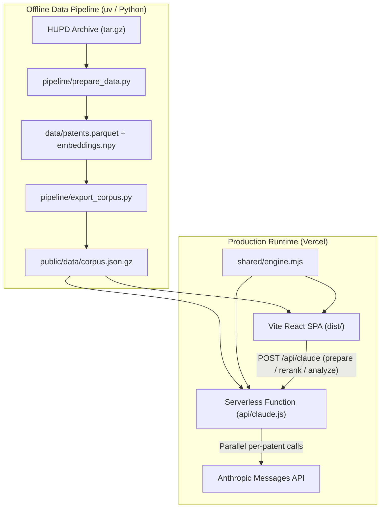

# Verbatim — Technical Architecture & Specification

This document describes the production runtime, retrieval algorithm, explainability layer, deterministic quote guardrail, and serverless security boundaries of Verbatim.

---

## 1. System Topology

Both the browser client and `api/claude.js` share two canonical sources of truth:
1. `shared/engine.mjs` — retrieval, OOD scoring, guardrail verification, rejection diagnostics, and prompt templates.
2. `public/data/corpus.json.gz` — a single 3.32 MB gzipped JSON asset containing 3,511 CPC `G06` patent records enriched with `cpc`, `cpc_group`, `date`, `app`, and parsed `depends_on` claim dependency arrays.

---

## 2. Retrieval Engine (`BM25F` + Technical Bigrams)

### 2.1 Multi-Field Normalization (BM25F)
Unlike flat BM25—where long claims dilute title and abstract matches—Verbatim applies independent field length normalization before saturation (`k1 = 1.2`):

| Field | Weight ($w_f$) | Length Norm ($b_f$) | Rationale |
| :--- | :---: | :---: | :--- |
| `title` | `3.00` | `0.40` | Concise high-signal summary of the core invention |
| `abstract` | `2.00` | `0.55` | Functional architecture and technical vocabulary |
| `indep` | `1.00` | `0.65` | Independent claims defining core legal scope |
| `dep` | `0.35` | `0.70` | Dependent claims adding specific implementation terms |

### 2.2 Technical Bigrams
Adjacent non-stopword stemmed pairs (e.g., `neural_network`, `power_loss`, `virtual_machin`) are extracted from `title`, `abstract`, and `indep` claims, pruned at `df >= 2` (37,910 retained bigrams), and scored with BM25 saturation (`bigramBoost = 0.40`). Dependent claims are excluded from bigram indexing because repeated preambles (`"the method of claim 1..."`) add index bloat without discriminative value.

### 2.3 Multi-Signal Out-of-Domain (OOD) Gate
To avoid wasting LLM calls or displaying misleading matches on non-computing inventions (e.g., chemistry, mechanical tooling), Verbatim computes a transparent composite domain score:

$$\text{domain}(q) = 0.60 \cdot \text{commonTermRatio}(q) + 0.40 \cdot \text{topDensity}(q)$$

- `commonTermRatio`: fraction of distinct query terms appearing in at least `0.5%` of the corpus.
- `topDensity`: top BM25F score normalized by total query IDF weight, clamped to `[0, 1]`.
- The threshold (`0.47`) is calibrated exclusively on the development split (`dev`: max OOD `0.450`, min in-domain `0.497`, accuracy `19/19`) and evaluated once on the held-out test split (`20/20` in-domain accepted, `9/10` OOD refused).

---

## 3. Verbatim Quote Guardrail & Rejection Diagnostics

`verifyQuote(quote, claimText)` enforces two strict conditions:
1. `quote.trim().length >= 12` (rejects empty strings and trivial fragments).
2. `claimText.includes(quote)` (exact character-for-character substring match, zero silent normalization).

When verification succeeds, `locateQuote` records exact character offsets `[start, end]`, rendered as `VERBATIM EXACT · [start..end]`.

When verification fails, the claim status is downgraded to `unverified`, `quote` is cleared to `""`, and `diagnoseQuoteRejection` classifies the failure for analyst transparency without relaxing the guardrail:

| Diagnostic Reason | Trigger Condition |
| :--- | :--- |
| `empty` | Model asserted overlap with an empty quote |
| `too_short` | Quote length `< 12` characters |
| `case_mismatch` | Matches only under case-insensitive comparison |
| `whitespace_or_punctuation_drift` | Matches after whitespace/quote/punctuation normalization |
| `ellipsis_or_omission` | Contains `...` / `…` stitching separate fragments |
| `paraphrase_high_overlap` | Token overlap `>= 50%`, rephrased sentence |
| `hallucination_low_overlap` | Token overlap `< 50%`, unanchored text |

---

## 4. Serverless API Security (`api/claude.js`)

1. **No proxy abuse**: Clients send only `{ task, invention, pubs }`. Every prompt is assembled server-side from `public/data/corpus.json.gz`; unknown or duplicate publication numbers return `422`.
2. **Delimiter hardening**: Angle brackets (`<`, `>`) are stripped from user input before embedding inside `<invention>...</invention>` tags.
3. **Origin enforcement**: `POST /api/claude` validates `Origin` host equality against `x-forwarded-host || host` (`403` otherwise).
4. **Parallel claim analysis**: For `task === "analyze"`, each patent runs in its own parallel `client.beta.messages.create` call (`Promise.allSettled`, `max_tokens: 3500`, with server-side fallback beta enabled), cutting latency, preventing output truncation, and isolating single-patent upstream failures (`partialFailures`).
5. **Bounded rate limiting**: Per-instance sliding-window limiter caps tracked IPs (`MAX_TRACKED_IPS = 2000`), enforces `12` analyses/hour and `40` calls/hour per IP plus a daily instance cap (`MAX_LIVE_CALLS_PER_DAY`), and emits `X-RateLimit-Limit`, `X-RateLimit-Remaining`, `X-RateLimit-Reset`, and `Retry-After` headers.
6. **Zero secret or PII logging**: Neither `ANTHROPIC_API_KEY` nor user invention text is ever written to logs or error responses.
